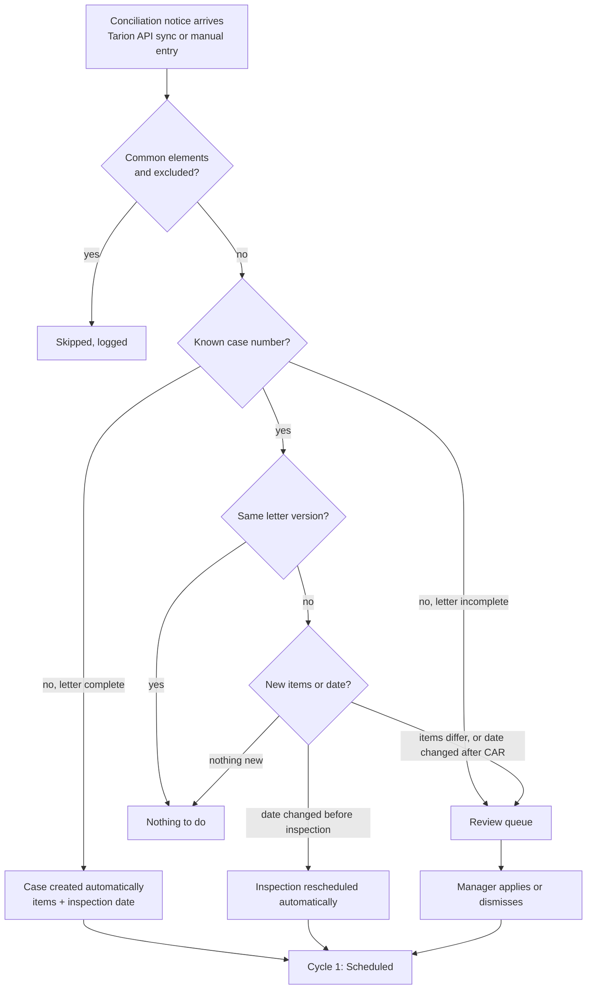
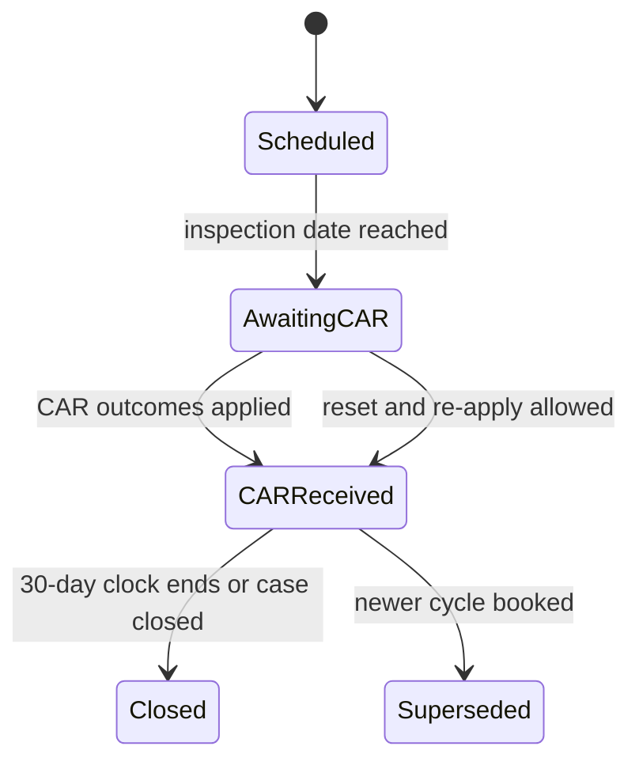
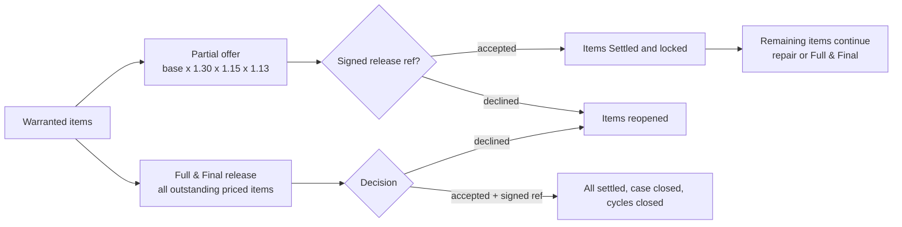

# Conciliation Manager — system flow and functionality

A blank, multi-tenant module: a new company signs up, creates a workspace, and starts with no data. Everything below is behaviour of the product, not imported content.

## 1. Case lifecycle

## 2. Inspection cycle stages (computed, never typed)

Per item, after the CAR: Warranted / Partially Warranted / Not Warranted / Withdrawn. Warranted items go either to **repair** (120-day clock, re-inspection if disputed) or to **cash settlement**.

## 3. Cash settlement

Rules enforced in the database: settled items are frozen; pending-signature items cannot be re-priced; only one open Full & Final offer per case; cash status cannot be edited directly, only through the offer / accept / decline actions; audit and activity logs are append-only.

## 4. Who can do what

| Role | Read | Change |
|---|---|---|
| manager | all cases | everything, add team, re-open cases |
| coordinator | all cases | nothing yet (read-only) |
| viewer | all cases | nothing |

Every row belongs to one company; one company can never read another's data.

## 5. Functionality map

- Dashboard: open inspections, scheduled / awaiting CAR / CAR received, overdue and due-in-7-days, pending cash, RB04 count, needs-attention list, freehold / common-elements toggle.
- Case folder: overview, items (inline edit, multi-select actions), inspection cycles, cash, activity log.
- Tarion intake: automatic sync, review queue, version-aware (the same letter is never reprocessed).
- Team: add teammates by email with a role.
- Not built yet: CAR PDF reading, release document generation, supervisor reminder emails, calendar sync, per-company Tarion credentials.
